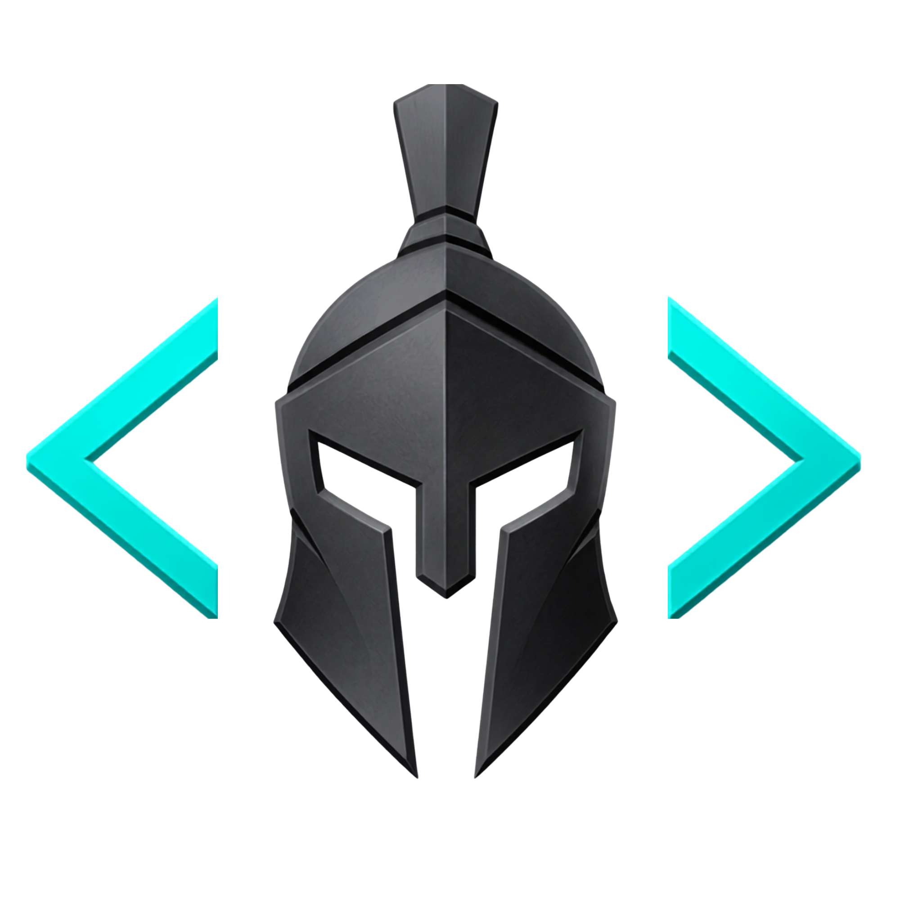

# CodeSpartan · Piensa. Crea. Escala.

  

**Ingeniería de software para empresas con operación real.** Modernizamos sistemas, conectamos herramientas y aplicamos inteligencia artificial donde puede ahorrar trabajo.

TechnoSpartan es la organización de desarrollo de [CodeSpartan](https://www.codespartan.es/). Trabajamos en proyectos de software a medida, desde el análisis del problema hasta su puesta en producción y evolución.

## Cómo trabajamos

- **Piensa:** analizamos el problema, los sistemas y los riesgos para definir un plan técnico priorizado.
- **Crea:** diseñamos y construimos soluciones por fases, desde un piloto hasta un proyecto completo.
- **Escala:** acompañamos la operación y la evolución del software, la infraestructura cloud y su fiabilidad.

Trabajamos con entregas incrementales, revisión de cambios, pruebas y automatización. Aplicamos IA con supervisión humana en los procesos sensibles y buscamos que el conocimiento y el código permanezcan en manos del cliente.

## Qué hacemos

- **Desarrollo de software a medida:** aplicaciones y plataformas adaptadas a procesos de negocio.
- **Modernización e integración:** evolución gradual de sistemas existentes y conexión entre herramientas.
- **Automatización e inteligencia artificial:** reducción de tareas manuales con trazabilidad y revisión humana donde corresponde.
- **Cloud y operación:** infraestructura, despliegues, observabilidad y soporte para sistemas en producción.

## Proyectos

- **TrackWorks:** plataforma de gestión de mantenimiento para empresas de reparación con técnicos en campo, en producción en Estados Unidos. [Ver el caso de éxito](https://www.codespartan.es/casos-de-exito/trackworks/).
- **[DentalFlow](https://www.dental-ia.es/):** seguimiento de citas y presupuestos para clínicas dentales. MVP funcional, con un piloto en preparación; no sustituye al software clínico.
- **LedgerMind AI:** herramienta funcional que recoge facturas del correo, extrae datos fiscales y los consolida en un informe.
- **Mambo Cloud:** plataforma propia para automatizar infraestructura, seguridad, observabilidad y despliegues; operativa y en evolución.

## Tecnologías

Trabajamos habitualmente con **TypeScript, Node.js, Kubernetes, Azure e IA agéntica**, y con tecnologías como **Java, PostgreSQL y Kafka** cuando el proyecto lo requiere. Elegimos las herramientas según el problema y el contexto de cada equipo.

## Colabora

Si tienes una incidencia o una propuesta para un repositorio público, consulta su documentación y nuestras [instrucciones de contribución](https://github.com/TechnoSpartan/.github/blob/main/CONTRIBUTING.md).

## Contacto y redes

- 🌐 [codespartan.es](https://www.codespartan.es/)
- 📧 [contacto@codespartan.es](mailto:contacto@codespartan.es)
- 💼 [LinkedIn](https://www.linkedin.com/company/codespartan)
- 📷 [Instagram](https://www.instagram.com/codespartan_cloud_and_ai_tools/)
- 👍 [Facebook](https://www.facebook.com/codespartan)
- 𝕏 [X](https://x.com/CodeSpartan_)

Los repositorios públicos se distribuyen bajo sus respectivas licencias; consulta el archivo `LICENSE` de cada proyecto.
